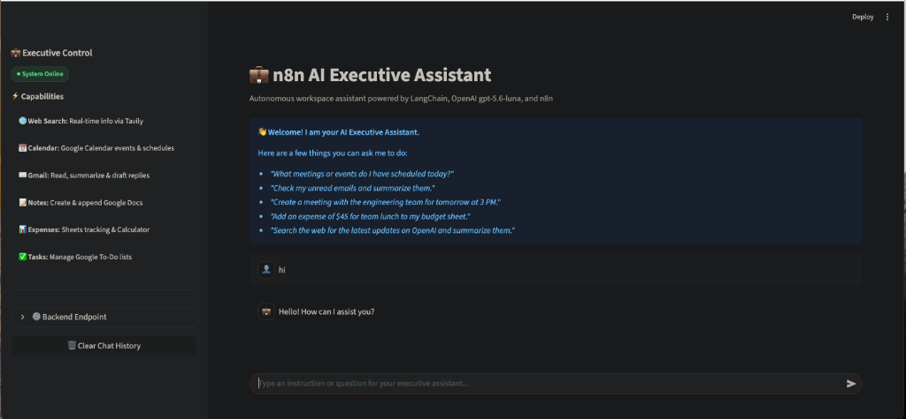

# 💼 n8n AI Executive Assistant (n8n + Streamlit)

An autonomous **AI Executive Assistant** built with **n8n** (powered by LangChain & OpenAI gpt-5.6-luna) and an interactive **Streamlit** chat frontend.

The assistant can search the web, manage Google Calendar events, summarize and send emails via Gmail, take notes in Google Docs, organize tasks in Google Tasks, and track expenses in Google Sheets with a built-in calculator.

---

## 🖥️ Interface Preview



---

## 🏗 Architecture Overview

```
┌─────────────────────────────────┐
│     Streamlit Web UI (app.py)   │
│  "💼 n8n AI Executive Assistant" │
└────────────────┬────────────────┘
                 │ HTTP POST
                 ▼
┌─────────────────────────────────┐
│       n8n Webhook Endpoint      │
└────────────────┬────────────────┘
                 │
                 ▼
┌─────────────────────────────────┐
│      AI Agent (LangChain)       │ ◄── OpenAI Chat Model (gpt-5.6-luna)
│   (Instructed by sysprompt.md)  │ ◄── Memory (Window / Simple Memory)
└────────────────┬────────────────┘
                 │
      ┌──────────┴────────────────────────┬─────────────────────┐
      ▼                                   ▼                     ▼
┌──────────────┐                  ┌──────────────┐       ┌──────────────┐
│  Notes Tool  │                  │   Calendar   │       │    Gmail     │
│ (Google Docs │                  │   (Google    │       │ (Read/Send)  │
│   & Drive)   │                  │  Calendar)   │       └──────────────┘
└──────────────┘                  └──────────────┘
      ▼                                   ▼                     ▼
┌──────────────┐                  ┌──────────────┐       ┌──────────────┐
│ Web Search   │                  │   Expense    │       │ Google Tasks │
│  (Tavily)    │                  │ (Sheets +    │       │  (To-Dos)    │
│              │                  │  Calculator) │       │              │
└──────────────┘                  └──────────────┘       └──────────────┘
                 │
                 ▼
┌─────────────────────────────────┐
│       Respond to Webhook        │
└────────────────┬────────────────┘
                 │ Returns JSON: {"output": "..."}
                 ▼
┌─────────────────────────────────┐
│     Streamlit Chat Response     │
└─────────────────────────────────┘
```

---

## ⚡ Core Capabilities

1. **🌐 Web Search:** Real-time information and factual queries via Tavily / Google Search.
2. **📅 Calendar Management:** Schedule meetings, check single events, or fetch today's agenda via Google Calendar.
3. **✉️ Gmail Management:** Read inbox messages, summarize email threads, and draft/send replies via Gmail.
4. **📝 Notes Management:** Create notes documents and append thoughts/summaries via Google Docs.
5. **📊 Expense Tracking:** Log new expenses, calculate totals, and retrieve history via Google Sheets + Calculator.
6. **✅ Task Management:** Create to-do items, list open tasks, and mark them completed via Google Tasks.

---

## 📂 Repository Structure

```text
├── app.py              # Streamlit chat interface
├── test_webhook.py     # Command-line script to test n8n webhook
├── workflow.json       # Exported n8n workflow (ready to import)
├── sysprompt.md        # Master system prompt and rules for the AI Agent
├── pyproject.toml      # Project dependencies (PEP 621)
├── uv.lock             # Deterministic lockfile for uv
├── requirements.txt    # Standard pip dependencies
├── .env.example        # Environment variables template
├── .gitignore          # Git ignore rules
└── README.md           # Project documentation
```

---

## 🚀 Getting Started

### Prerequisites

- **Python 3.12+**
- **n8n** running locally (`http://localhost:5678`) or on a hosted instance.
- **OpenAI API Key** (for `gpt-5.6-luna`).
- *(Optional)* Google OAuth credentials for Gmail, Google Calendar, Google Docs, Google Sheets, and Google Tasks.
- *(Optional)* Tavily API Key for web search.

---

### Step 1: Set Up n8n Backend

1. Open your n8n workspace at `http://localhost:5678`.
2. Click **Add Workflow** ➔ click the **`...` (Menu)** in the top right ➔ select **Import from File...**
3. Select and import [`workflow.json`](./workflow.json).
4. Configure your credentials inside n8n:
   - **OpenAI Chat Model:** Add your OpenAI API Key.
   - **Google Tools:** Authenticate your Google OAuth account (Calendar, Gmail, Drive, Docs, Sheets, Tasks).
   - **Tavily:** Add your Tavily API Key for web search.
5. In the top-right corner of n8n, toggle the workflow from **Inactive** to **Active** (Publish).
6. Double-click the **Webhook** node and copy the **Production URL** (e.g. `http://localhost:5678/webhook/<webhook-id>`).

---

### Step 2: Configure Environment Variables

Copy the example environment file:

```bash
cp .env.example .env
```

Open `.env` and set your n8n production webhook URL:

```env
N8N_WEBHOOK_URL=http://localhost:5678/webhook/your-webhook-id-here
```

---

### Step 3: Set Up and Run Frontend

You can run the project using **`uv`** (fastest) or standard **Python virtual environment**.

#### Method A: Using `uv` (Recommended)

If you have `uv` installed (`brew install uv`):

```bash
# 1. Run the Streamlit Chat App directly
uv run streamlit run app.py

# 2. (Optional) Test the webhook from CLI
uv run python test_webhook.py
```

#### Method B: Using Standard Python Virtual Environment

```bash
# 1. Create and activate virtual environment
python3 -m venv .venv
source .venv/bin/activate

# 2. Install dependencies
pip install -r requirements.txt

# 3. Launch Streamlit
streamlit run app.py
```

---

## 🧪 Testing the Webhook Directly

To verify that n8n is responding without launching the browser UI:

```bash
python test_webhook.py
```

You will see the request status and the formatted AI response directly in your terminal.

---

## 🛠 Troubleshooting

- **Empty response or status 404 / 500:**
  - Make sure your n8n workflow is switched to **Active** when using `/webhook/...` URLs.
  - If using a test URL (`/webhook-test/...`), you must click **"Listen for test event"** in n8n before sending each request.
- **Google Docs Permission Error:**
  - Ensure Google Docs expects the **Document ID** (from the doc URL), not just the file title.
  - Check that the Google OAuth credentials have `drive` or `documents` scopes enabled in Google Cloud Console.

---

## 📄 License

MIT License. Feel free to use and customize for your own projects!

